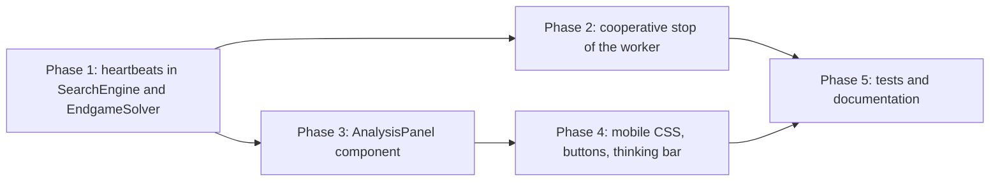

# Review the current Web architecture of Connect-4

The Connect-4 project needs a review against the current upgraded versiuons of Stello and Checkers.

Connect-4 is probably closer to Stello as it was developed using the same framwork as stello.

Check the files

- Web architecture review.md
- Checkers web architecture plan.md
- Stello web architecture plan.md

Write review and findings in this document and also a implementation plan for the findings that needs fixing.

---

## 1. Summary

Connect-4 is a close copy of the **Stello web architecture as it was before the upgrade**: the same `IEngineHost` with `LocalEngineHost` (WPF) and `WebEngineHost` (browser), the engine in a Web Worker with its own .NET runtime, a source-generated JSON protocol, a `ProgressPoster` that sends at most 10 reports a second, CSS container queries, local storage for the settings and the appearance, and the menu that follows the board.

So the starting point is good. Most of what Checkers had to add (a Web Worker, `IEngineHost`, Move Now, saved settings, the loading percentage, the dialog grid, keyboard access to the board) Connect-4 already has.

What is missing is the **Stello upgrade from 21 October 2026** (commits `bfabc5d` and `e9d289e`), and it matters more in Connect-4 than in Stello:

| Upgrade in Stello | Connect-4 today | Why it matters more in Connect-4 |
|---|---|---|
| Progress "heartbeat" every 100 ms during a long root move | Reports only after each root move, and nothing during the endgame solve | Only 7 root moves; at depth 20+ one root move, or the whole solve (up to 30 empty cells), takes seconds. The analysis panel freezes, and the worker never looks for a stop signal. |
| Stopping the worker cooperatively (SharedArrayBuffer signal, COOP/COEP headers), `terminate()` only as a fallback | Move Now, Back, Forward, New Game, Switch Sides and Open during a search **terminate the worker** | A restart throws away 2 × 2^24-entry tables (≈ 128 MiB + ≈ 84 MB, not 16 MB as in Stello), re-parses the 4.7 MB opening book, and loses the endgame table, whose results "never go stale". |
| `AnalysisPanel` component that renders on its own | The analysis is inline in `Home.razor`, so every report renders `Home` and `Board` | `Board.OnParametersSet` checks all 42 cells and `Describe()` builds 7 ARIA labels with LINQ at each report. |
| `100dvh`, landscape and portrait breakpoints | `100vh`, a single `max-width: 700px` breakpoint | The same landscape trap as Stello had. Connect-4 also has a `margin-top` that repeats the board formula, so it must change with it. |
| Thinking bar and New / Back / Forward / Move Now buttons in the Status panel | Only the menus and Ctrl+key shortcuts | Phones and tablets have no keyboard; Move Now is hidden in the Game menu. |

**Verdict:** apply the Stello upgrade to Connect-4 in five phases (section 4). No new architecture is needed; the changes are the same as in Stello, with four Connect-4 specific details:

1. The endgame solver is a separate class (`EndgameSolver`), so it needs its own heartbeat hook.
2. The board size formula is used twice in `app.css` and should become one CSS variable.
3. The stop signal should only be reset when a search starts, not on every message to the worker.
4. Touch screens keep the `:hover` preview disc visible after a tap ("sticky hover").

---

## 2. What was compared

| Project | Version reviewed | Web architecture |
|---|---|---|
| **Stello** | `e9d289e` "Fixed after Argon review" (on top of `bfabc5d` "Stello Web Architecture Implementation Plan finished") | Engine in a Web Worker, heartbeats, cooperative stop with a SharedArrayBuffer, `AnalysisPanel`, `100dvh`, orientation breakpoints, thinking bar and action buttons |
| **Checkers** | `b02d6e1` "Gemini Argen review of plan implementation fixes" (on top of `3aaf4a9`) | Moved from a main-thread engine to the same worker design as Stello, plus saved settings, Move Now, pointer drag and drop, `AnalysisPanel`, new CSS |
| **Connect-4** | `main` (with the menu alignment and Help menu changes of 18 October) | Stello's design from before the upgrade |

Files read in Connect-4: `Connect4.Web` (`Program.cs`, `Pages/Home.razor`, `Components/Board.razor`, `Services/WebEngineHost.cs`, `Worker/EngineWorker.cs`, `Worker/EngineProtocol.cs`, `wwwroot/js/*.js`, `wwwroot/css/app.css`, `wwwroot/index.html`, `wwwroot/staticwebapp.config.json`), `Connect4.App` (`MainViewModel`, `AnalysisViewModel`, `IEngineHost`) and `Connect4.Engine` (`SearchEngine`, `ComputerPlayer`, `Endgame/EndgameSolver`).

---

## 3. Findings

### 3.1 Scorecard

| # | Area | Stello now | Checkers now | Connect-4 now | Action |
|---|---|---|---|---|---|
| F1 | Engine off the main thread | Web Worker | Web Worker | Web Worker | None |
| F2 | Live progress during a long root move | Heartbeat in `CheckAbort` | Reports from `NegaMax` | **Missing** | Phase 1 |
| F3 | Live progress during the endgame solve | Heartbeat (solver inside `SearchEngine`) | n/a | **Missing**: one report when the solve starts | Phase 1 |
| F4 | Move Now / Stop in the browser | Signal, wait up to 300 ms, then `terminate()` | Same | **`terminate()` only** | Phase 2 |
| F5 | Analysis renders the board | No (`AnalysisPanel`) | No (`AnalysisPanel`) | **Yes** | Phase 3 |
| F6 | `100dvh` on mobile | Yes | Yes | **No** | Phase 4 |
| F7 | Landscape phones | Side by side, 200 px panels | Side by side | **Stacked; the panels fall below the screen** | Phase 4 |
| F8 | Portrait phones | Board at most 62 % of the height | At most 62 dvh | **Board can take the whole height** | Phase 4 |
| F9 | Touch buttons and thinking bar | Yes | Yes | **No** | Phase 4 |
| F10 | Sticky hover preview on touch | n/a (no hover preview) | n/a | **Shown after a tap** | Phase 4 (small) |
| F11 | Docs describe the stop | Updated | Updated | **Say "terminates the worker"** | Phase 5 |
| — | Settings and appearance saved | Yes | Added | Yes | None |
| — | Move Now command, menu, Ctrl+M | Yes | Added | Yes | None |
| — | Keyboard and screen reader access to the board | `<button>` squares | Added `tabindex` | `<button>` columns with `aria-label` | None |
| — | Loading percentage, dialog grid, reduced motion | Yes | Added | Yes | None (add the thinking bar to reduced motion) |
| — | Opening book without a download | Downloads `OPENING.bin` | Embedded | Embedded | None |
| — | Menu follows the board | Yes | — | Yes (18 October) | None |

### 3.2 Details

#### F2 – No progress during a long root move (high)

[`SearchEngine.SearchRoot`](Connect4.Net/Connect4.Engine/SearchEngine.cs) calls `Report(...)` only **after** each root move. Connect-4 has at most 7 root moves, so in a deep iteration one report can be seconds after the previous one. `Negamax` already calls `CheckAbort()` every 1 024 nodes, but `CheckAbort()` only looks at the tokens and the clock.

Effects:

- The Analysis panel (nodes, time, move) freezes during a deep iteration, on the desktop as well as in the browser.
- In the browser, the worker only gets a chance to look for a stop signal in `ProgressPoster.Report`. Without regular reports, a cooperative stop (F4) cannot work.

Stello fixed exactly this in `CheckAbort()`: if 100 ms have passed since the last report, it sends the last known values again with fresh node and time counts.

#### F3 – No progress during the endgame solve (high)

[`SearchEngine.SolveRoot`](Connect4.Net/Connect4.Engine/SearchEngine.cs) sends one report ("solving (N empty)") and then calls `EndgameSolver.Analyze`, which can run for seconds (the threshold is 30 empty cells; the time roughly doubles per empty cell). [`EndgameSolver.Negamax`](Connect4.Net/Connect4.Engine/Endgame/EndgameSolver.cs) checks the token every 1 024 nodes, but nothing reports progress, so:

- the node count and time freeze during the solve;
- in the browser, the token passed to the solver is linked to `moveNowCts`, which only `ProgressPoster` can cancel, and `ProgressPoster` is never called during the solve.

In Stello the solver is part of `SearchEngine`, so its heartbeat in `CheckAbort()` covered both. Connect-4 needs a small hook in `EndgameSolver` (Phase 1.3).

#### F4 – Move Now and Stop terminate the worker (high)

[`WebEngineHost.ChooseMoveAsync`](Connect4.Net/Connect4.Web/Services/WebEngineHost.cs) calls `Restart(client)` (`worker.terminate()` and a new worker) whenever `moveNowToken` or `cancellationToken` fires. `MainViewModel` cancels the search in Back, Forward, New Game, Switch Sides, Set Mode and Open, so all of these restart the worker if the computer is thinking.

A restart in Connect-4:

- allocates the 2^24-entry search table again (128 MiB) and, at the next solve, the endgame table (≈ 84 MB). This is the most expensive restart of the three projects;
- loads the .NET runtime again and parses the embedded 4.7 MB opening book again;
- loses the endgame table, which the engine deliberately keeps between moves and games because its results never go stale;
- plays the best move of the **last progress report** for Move Now (up to 100 ms old), not the engine's own result.

Stello's fix: a 4-byte `SharedArrayBuffer` (0 = run, 1 = Move Now, 2 = cancel) that the page writes and the worker reads in `ProgressPoster.Report`. The page then waits up to 300 ms for the worker to return; only if the signal is not available (no cross-origin isolation) or the wait times out is the worker terminated. `SharedArrayBuffer` needs the `Cross-Origin-Opener-Policy: same-origin` and `Cross-Origin-Embedder-Policy: require-corp` headers in `staticwebapp.config.json`.

COOP/COEP check for Connect-4:

- All app files (`_framework`, textures, the About picture, the docs Markdown) are same-origin.
- KaTeX and Mermaid on the docs pages come from jsDelivr, but `docs.js` loads them with `crossOrigin = 'anonymous'` (CORS), which `require-corp` accepts. This is the same as in Stello.
- "Rules & Documentation" opens with `noopener`, and links to GitHub are navigations, which COOP/COEP do not block.

Hardening compared to Stello: Stello's `engine-client.js` resets the signal to 0 at **every** `post()`. In Connect-4 `WebEngineHost.NewGame()` posts `newGame` to the worker; if a future change ever posts it while a search is being stopped, the reset would clear the stop signal. Reset the signal only when a `chooseMove` is posted (Phase 2.2).

#### F5 – Every analysis report renders the board (medium)

[`Home.razor`](Connect4.Net/Connect4.Web/Pages/Home.razor) subscribes to `Vm.Analysis.PropertyChanged` (line 135) and renders the whole page. `Board` takes `Cells` (a reference type), so Blazor always renders it again with its parent. At up to 10 reports a second (more with the heartbeats from Phase 1), `Board.OnParametersSet` checks all 42 cells, and `Describe()` builds the 7 column labels with LINQ, although no disc has changed. Stello and Checkers both moved the analysis into its own component.

#### F6, F7, F8 – Mobile layout (medium)

In [`app.css`](Connect4.Net/Connect4.Web/wwwroot/css/app.css):

- `.app { height: 100vh; }` (line 18): on phones with a collapsing address bar the bottom of the page is cut off. Stello added `height: 100dvh;`.
- `@media (max-width: 700px)` (line 334) stacks the board and the panels for **every** narrow screen. On a phone in landscape (e.g. 667 × 375) the board takes the full height and the Status panel is below the screen, with empty space left and right. In portrait, `width: min(100cqw, 100cqh - 2rem)` lets the board take the whole height on short phones.
- `.side-panels { margin-top: calc(min(100cqh - 2rem, 100cqw - 252px) / 7); }` (line 295) repeats the board width formula to put the panels level with the board face. A compact landscape layout with 200 px panels changes the board formula, so this line would be wrong unless it changes too. One CSS variable (`--board-size`) for both avoids that.

#### F9 – No touch buttons, no visible thinking indicator (medium)

The Status panel only shows text. On a phone, Back, Forward, New Game and Move Now take two taps through the menus, and Ctrl+M does not exist. While the computer thinks, the only sign is "Thinking…" in the Status text; with the Analysis panel off it is easy to miss. Stello added a thinking bar and a row of buttons (New, Back, Forward, and Move Now while thinking).

#### F10 – Sticky hover preview on touch screens (low)

The preview disc above a column is shown with `.column:hover` (lines 193–218). On touch screens `:hover` stays on the last tapped element, so after the computer has replied the human's next disc stays visible above the column that was tapped last. Wrapping these rules in `@media (hover: hover)` shows the preview only where there is a real mouse.

#### F11 – Documentation (low)

These texts describe the worker being terminated and will be wrong after Phase 2:

- [`docs/brain/10-time-control.md`](docs/brain/10-time-control.md) line 67: "the page terminates the worker instead".
- [`docs/brain/12-app-integration.md`](docs/brain/12-app-integration.md) line 73 (sequence diagram note) and the browser bullet at line 50.
- [`Connect 4 porting documentation.md`](Connect%204%20porting%20documentation.md): Phase 9/10 text about the worker; add a short note on the upgrade.
- [`Make a .Net implementation of Connect 4.md`](Make%20a%20.Net%20implementation%20of%20Connect%204.md) line 320 (the original specification): leave it as history, or add "(changed later: cooperative stop, see the porting documentation)".

### 3.3 Not taken from Checkers or Stello

| Idea | Reason |
|---|---|
| Pointer-event drag and drop (Checkers) | Connect-4 drops a disc with one tap on a column; there is nothing to drag. |
| `touch-action: none` on the board (Checkers) | Only needed for dragging; it would block scrolling on phones. |
| Conditional AOT, only in CI (Checkers) | Optional. A local `dotnet publish -c Release` is slower, but the CI result is the same. Not part of this plan. |
| Catching `OperationCanceledException` in `EngineWorker.ChooseMove` and returning a dummy move (Checkers) | Stello lets the worker answer with an error, and `WebEngineHost` turns it into `OperationCanceledException`. That keeps the protocol honest; keep the Stello way. |
| Book learning in the worker (review section 2.2) | Connect-4's book is a fixed table of solved positions; there is no learning. |
| Native WebAssembly threads | Same reason as in the review: not needed, more interop cost. |

---

## 4. Implementation plan

> [!IMPORTANT]
> Do not break the tests in `Connect4.Net/Connect4.Engine.Tests` and `Connect4.Net/Connect4.App.Tests`, or the WPF app `Connect4.Net/Connect4.WPF`. Build after each phase with `dotnet build Connect4.Net/Connect4.Net.slnx`.



Phase 2 depends on Phase 1: without heartbeats the worker does not look at the signal during a long root move or a solve, and the 300 ms wait would usually end with `terminate()` anyway.

### Phase 1 – Heartbeats in the engine (`Connect4.Engine`)

#### 1.1 `SearchEngine` fields

In [`SearchEngine.cs`](Connect4.Net/Connect4.Engine/SearchEngine.cs), next to `_progress`:

```csharp
// What the last report said; a heartbeat repeats it with new node and time counts (Stello design).
private const long HeartbeatMs = 100;
private long _lastReportMs;
private Position _reportPosition;
private int _reportDepth;
private int _reportColumn = -1;
private int _reportBest;
private int _reportScore;
private ScoreKind _reportKind;
private bool _reportSolving;
```

In `Search(...)`, after `_clock.Restart();`:

```csharp
_lastReportMs = 0;
_reportColumn = -1;
_reportPosition = position;
```

#### 1.2 Set the heartbeat values before each root move

`SearchRoot` needs the best move of the previous iteration, so the heartbeat has a best move before the first root move of an iteration has been searched. Change the call in `Search` to `best = SearchRoot(position, depth, root, best);` and the signature to `SearchRoot(Position position, int depth, int[] root, Best previous)`. At the top of the `foreach (int column in root)` loop:

```csharp
_reportDepth = depth;
_reportColumn = column;
_reportBest = ties.Count > 0 ? ties[0] : previous.Columns[0];
_reportScore = ties.Count > 0 ? bestScore : previous.Score;
_reportKind = ties.Count > 0 ? Kind(bestScore) : previous.Kind;
_reportSolving = false;
```

#### 1.3 Heartbeat in `CheckAbort()` and in the solver

`Report(...)` records the time of the report, and `CheckAbort()` sends a heartbeat when 100 ms have passed. The heartbeat comes **before** the token checks, so a stop signal read by the worker's `ProgressPoster` (Phase 2) takes effect at once:

```csharp
private void CheckAbort()
{
    Heartbeat(_nodes);
    _cancel.ThrowIfCancellationRequested();
    if (_moveNow.IsCancellationRequested || _clock.ElapsedMilliseconds >= _hardLimitMs)
    {
        throw new SearchAbortedException();
    }
}

private void Heartbeat(long nodes)
{
    if (_progress is null || _reportColumn < 0 || _clock.ElapsedMilliseconds - _lastReportMs < HeartbeatMs)
    {
        return;
    }

    _lastReportMs = _clock.ElapsedMilliseconds;
    _progress.Report(new SearchInfo(
        _reportDepth, _reportColumn, _reportBest, _reportScore, _reportKind, nodes, _clock.Elapsed,
        PrincipalVariation(_reportPosition, _reportBest), _reportSolving));
}
```

Update `Report(...)` to set `_lastReportMs = _clock.ElapsedMilliseconds;` before it calls `_progress.Report(...)`.

In [`EndgameSolver.cs`](Connect4.Net/Connect4.Engine/Endgame/EndgameSolver.cs), add an internal hook that is called at the existing cancellation check (the class stays a 1:1 port; the hook is a no-op when it is not set):

```csharp
/// <summary>Called every 1 024 nodes, before the token is checked (progress and stop signals in the browser).</summary>
internal Action? Heartbeat { get; set; }
```

```csharp
if ((NodeCount & CancellationCheckMask) == 0)
{
    Heartbeat?.Invoke();
    _cancellation.ThrowIfCancellationRequested();
    ...
}
```

In `SearchEngine.SolveRoot`, set the heartbeat values after the "solving" report, and attach and detach the hook around `Analyze`:

```csharp
_reportDepth = position.EmptyCells;
_reportColumn = heuristic.Columns[0];
_reportBest = heuristic.Columns[0];
_reportScore = heuristic.Score;
_reportKind = heuristic.Kind;
_reportSolving = true;
_endgame.Heartbeat = () => Heartbeat(_nodes + _endgame.NodeCount - nodesBefore);
try
{
    ...
}
finally
{
    _endgame.Heartbeat = null;
    _nodes += _endgame.NodeCount - nodesBefore;
}
```

(`nodesBefore` must be declared before the lambda; it already is.)

The desktop benefits too: the WPF Analysis panel now ticks during long iterations and solves.

#### 1.4 Check

- `Progress_ReportsEveryIteration` still passes: a heartbeat repeats the current depth, so the sequence of distinct depths does not change.
- The test that checks `info.Solving` still passes: solving heartbeats only happen when the solver runs.
- Build `Connect4.Engine`, `Connect4.App`, `Connect4.WPF`.

### Phase 2 – Cooperative stop of the worker (`Connect4.Web`)

#### 2.1 `wwwroot/staticwebapp.config.json`

Add the headers that make the page cross-origin isolated (needed for `SharedArrayBuffer`); keep the existing settings:

```json
{
  "globalHeaders": {
    "Cross-Origin-Opener-Policy": "same-origin",
    "Cross-Origin-Embedder-Policy": "require-corp"
  },
  "navigationFallback": { ... unchanged ... },
  "mimeTypes": { ... unchanged ... }
}
```

#### 2.2 `wwwroot/js/engine-client.js`

```javascript
// Lets the page stop a running search without terminating the worker (needs cross-origin isolation).
const canShareMemory = typeof SharedArrayBuffer !== 'undefined' && self.crossOriginIsolated;
const signalBuffer = canShareMemory ? new SharedArrayBuffer(4) : null;
const signalView = signalBuffer ? new Int32Array(signalBuffer) : null;
```

- `post(command, args, includeBuffer = false)`: add `signalBuffer` to the message when `includeBuffer && signalBuffer`.
- `start(...)`: `return post('init', [hashLogSize, endgameLogSize], true);`
- `call(command, ...args)`: reset the signal **only** for a new search (Connect-4 hardening, see F4):

  ```javascript
  if (command === 'chooseMove' && signalView) {
      Atomics.store(signalView, 0, 0);
  }
  ```

- New export:

  ```javascript
  // Asks a running search to stop (1 = Move Now, 2 = cancel); false if the worker can only be terminated.
  export function signal(code) {
      if (!signalView) {
          return false;
      }
      Atomics.store(signalView, 0, code);
      return true;
  }
  ```

- Change the comment on `terminate()` to "Force-stops the worker when the signal is not available or not answered in time."

#### 2.3 `wwwroot/js/engine-worker.js`

```javascript
let signalView = null;
...
runtime.setModuleImports('engine-worker', {
    postProgress: json => self.postMessage({ type: 'progress', json }),
    pollSignal: () => signalView ? Atomics.load(signalView, 0) : 0,
});
...
const { id, command, args, signalBuffer } = e.data;
if (signalBuffer) {
    signalView = new Int32Array(signalBuffer);
}
```

#### 2.4 `Worker/EngineWorker.cs`

```csharp
[JSExport]
public static string ChooseMove(string request)
{
    (Game game, SearchLimits limits) = EngineProtocol.ReadRequest(request);
    using var cancel = new CancellationTokenSource();
    using var moveNow = new CancellationTokenSource();
    SearchResult result = Computer.ChooseMove(game, limits, new ProgressPoster(cancel, moveNow), cancel.Token, moveNow.Token);
    return EngineProtocol.WriteResult(result);
}

[JSImport("pollSignal", "engine-worker")]
private static partial int PollSignal();
```

`ProgressPoster` gets the two sources in its constructor, and `Report` reads the signal first (every report, including heartbeats, so at least every 100 ms):

```csharp
switch (PollSignal())
{
    case 2:
        _cancel.Cancel();
        return;
    case 1:
        _moveNow.Cancel();
        return;
}
```

The rest of `Report` (100 ms throttle, new depth / best move / solving always sent) is unchanged.

#### 2.5 `Services/WebEngineHost.cs`

Restructure `ChooseMoveAsync` as in Stello, with everything inside the `try` so progress keeps flowing during the wait:

```csharp
try
{
    if (await Task.WhenAny(search, stopped.Task) == search)
    {
        return EngineProtocol.ReadResult(await search);
    }

    bool isMoveNow = await stopped.Task;
    if (client.Invoke<bool>("signal", isMoveNow ? 1 : 2)
        && await Task.WhenAny(search, Task.Delay(StopGraceMs)) == search)
    {
        if (!isMoveNow)
        {
            Forget(search);
            throw new OperationCanceledException(cancellationToken);
        }

        try
        {
            // The engine's own result: the best move of the last finished iteration (or the solver's).
            return EngineProtocol.ReadResult(await search);
        }
        catch (JSException)
        {
            // The worker failed; restart it below.
        }
    }

    Forget(search);
    Restart(client);
    if (!isMoveNow)
    {
        throw new OperationCanceledException(cancellationToken);
    }

    return EngineProtocol.MoveNowResult(moves, last, clock.Elapsed);
}
finally
{
    _progress = null;
}
```

with `private const int StopGraceMs = 300;`. Update the class summary: "A running search is stopped with a signal through shared memory, which keeps the hash tables; the worker is only restarted when the signal is not available or not answered in time."

Edge case: the first solve allocates the endgame table (≈ 84 MB) before the solver runs, with no heartbeats during the allocation. A stop in that moment may hit the 300 ms limit and fall back to a restart. This is rare and safe; no change needed.

#### 2.6 Check

- Build. Locally the development server does not send COOP/COEP, so `self.crossOriginIsolated` is false and the old restart path is used; this also tests the fallback.
- On the deployed site (or a static server that sends the two headers), check `crossOriginIsolated` is `true` in the DevTools console. Start a long search (Settings: fixed depth 30, or time per move 30 s), press Move Now: the move comes at once, and in the DevTools "Memory" view the worker's memory stays allocated (no new worker appears in "Sources > Threads"). Do the same with Back during a solve.
- Check the docs pages still show formulas and diagrams (KaTeX and Mermaid from jsDelivr under COEP).

### Phase 3 – `AnalysisPanel` component (`Connect4.Web`)

#### 3.1 New `Components/AnalysisPanel.razor`

```razor
@using System.ComponentModel
@implements IDisposable

<aside class="panel analysis" aria-label="Analysis">
    <h2>Analysis</h2>
    <dl>
        <dt>Move:</dt><dd>@Analysis.Move</dd>
        <dt>Depth:</dt><dd>@Analysis.Depth</dd>
        <dt>Value:</dt><dd>@Analysis.Value</dd>
        <dt>Best move:</dt><dd>@Analysis.BestMove</dd>
        <dt>Line:</dt><dd class="line">@Analysis.Line</dd>
        <dt>Nodes:</dt><dd>@Analysis.Nodes</dd>
        <dt>Time:</dt><dd>@Analysis.Time</dd>
    </dl>
</aside>

@code {
    private bool _renderPending;

    [Parameter, EditorRequired]
    public AnalysisViewModel Analysis { get; set; } = default!;

    protected override void OnInitialized() => Analysis.PropertyChanged += OnChanged;

    public void Dispose() => Analysis.PropertyChanged -= OnChanged;

    // One render for the seven properties of a report.
    private void OnChanged(object? sender, PropertyChangedEventArgs e)
    {
        if (_renderPending)
        {
            return;
        }

        _renderPending = true;
        _ = InvokeAsync(async () =>
        {
            await Task.Yield();
            _renderPending = false;
            StateHasChanged();
        });
    }
}
```

#### 3.2 `Pages/Home.razor`

- Replace the inline `<aside class="panel analysis">…</aside>` (lines 65–76) with `<AnalysisPanel Analysis="Vm.Analysis" />`.
- Remove `Vm.Analysis.PropertyChanged += OnChanged;` (line 135) and `Vm.Analysis.PropertyChanged -= OnChanged;` (line 161).

`Home` (and so `Board`) now only renders when the view model or a cell changes.

### Phase 4 – Mobile layout, touch buttons and thinking bar (`Connect4.Web`)

#### 4.1 `Pages/Home.razor` – Status panel

After `<p>@Vm.Status</p>`:

```razor
@if (Vm.IsThinking)
{
    <div class="thinking-bar" role="progressbar" aria-label="Computer thinking">
        <div class="thinking-progress"></div>
    </div>
}
```

At the end of the Status `<section>`:

```razor
<div class="action-buttons">
    <button class="btn" disabled="@(!Vm.NewGameCommand.CanExecute(null))" @onclick="() => RunAsync(Vm.NewGameCommand)">New</button>
    <button class="btn" disabled="@(!Vm.UndoCommand.CanExecute(null))" @onclick="() => RunAsync(Vm.UndoCommand)">Back</button>
    <button class="btn" disabled="@(!Vm.RedoCommand.CanExecute(null))" @onclick="() => RunAsync(Vm.RedoCommand)">Forward</button>
    @if (Vm.IsThinking)
    {
        <button class="btn btn-primary action-span" @onclick="() => RunAsync(Vm.MoveNowCommand)">Move Now</button>
    }
</div>
```

The buttons use the same `RunAsync` as the menus, so they close an open menu and render afterwards. The Status section has `role="status"`; move the buttons outside the live region if screen readers read them on every status change (put them in a `<div>` after the `<p>` elements but give the texts their own `<div role="status">`).

#### 4.2 `wwwroot/css/app.css`

1. **`100dvh`** (line 18):

   ```css
   .app {
       display: flex;
       flex-direction: column;
       height: 100vh;
       height: 100dvh;
   }
   ```

2. **One board size variable** (lines 108–115 and 295). `--board-size` is set on `.content` (the size container's own `cq*` units refer to its parent, so set it on `.board-area`'s parent rule through a child selector instead):

   ```css
   .board-area, .side-panels {
       --board-size: min(100cqh - 2rem, 100cqw - 252px);
   }

   .board-area {
       flex: none;
       width: var(--board-size);
   }

   .side-panels {
       ...
       /* Level with the top of the board face, below the preview row. */
       margin-top: calc(var(--board-size) / 7);
   }
   ```

   (Container query units in a custom property are resolved where the property is used, against the nearest size container, which is `.content` for both elements.)

3. **Thinking bar and buttons.** Copy Stello's `.thinking-bar`, `.thinking-progress`, `@keyframes thinking-slide` and `.action-buttons` rules, with Connect-4's blue (`#1565c0`, as the loading ring) instead of Stello's green for `.thinking-progress` and `.btn-primary` (hover `#1976d2`, border `#0d47a1`). Add `.thinking-progress` to the reduced-motion rule:

   ```css
   @media (prefers-reduced-motion: reduce) {
       .disc, .thinking-progress {
           animation: none !important;
       }
   }
   ```

4. **Sticky hover** (lines 193–220): wrap the three `.column:hover …` rules in

   ```css
   @media (hover: hover) {
       ...
   }
   ```

5. **Breakpoints.** Replace `@media (max-width: 700px) { … }` (lines 334–350) with:

   ```css
   /* Landscape phones and small tablets: board and narrower panels side by side. */
   @media (max-width: 820px) and (min-aspect-ratio: 1/1) {
       .board-area, .side-panels {
           --board-size: min(100cqh - 2rem, 100cqw - 212px);
       }

       .side-panels {
           width: 200px;
       }
   }

   /* Portrait phones: panels below the board; the board leaves room for the Status panel and buttons. */
   @media (max-width: 700px) and (max-aspect-ratio: 1/1), (max-width: 500px) {
       .content {
           flex-direction: column;
           justify-content: flex-start;
           align-items: center;
       }

       .board-area, .side-panels {
           --board-size: min(100cqw, 62cqh);
       }

       .side-panels {
           align-self: stretch;
           width: auto;
           margin-top: 0;
       }
   }
   ```

   The menu alignment from 18 October follows `.board-area` with a `ResizeObserver`, so it keeps working in all three layouts.

#### 4.3 Check

Build, then in the browser's device toolbar: 1920 × 1080, 1280 × 720, 820 × 1180 (tablet portrait), 667 × 375 (phone landscape), 375 × 667 and 360 × 640 (phone portrait). In each, the board, the Status panel and the buttons are visible without scrolling, the panels line up with the top of the board face beside the board, and the menu starts at the board's left edge.

### Phase 5 – Tests and documentation

#### 5.1 Tests (`Connect4.Engine.Tests`)

Add to [`SearchEngineTests.cs`](Connect4.Net/Connect4.Engine.Tests/SearchEngineTests.cs), using a progress class that reports synchronously (not `Progress<T>`, which posts to a synchronisation context):

1. `Search_WithMoveNow_ReportsHeartbeatsAndReturnsLegalMove`: a midgame position with more than 30 empty cells, `SearchLimits.FixedDepth(40)` without the book, Move Now after 350 ms. Assert at least 3 reports, a playable column, and that the search returned (no exception).
2. `Solve_ReportsHeartbeats`: a position with 26–28 empty cells that takes more than 300 ms to solve (pick one from `Test positions/` or measure with `Connect4.Tools endgame measure`), `SearchLimits.Solve`. Assert more than one report with `Solving == true` and that `Nodes` grows between them.
3. `Solve_WithMoveNow_ReturnsHeuristicMove`: as 2, Move Now after 200 ms; the result has `Kind != ScoreKind.Exact` or is the heuristic move, and no exception is thrown.

The worker and SharedArrayBuffer path cannot be unit tested (it needs a browser); check it by hand as in 2.6.

#### 5.2 Documentation

- `docs/brain/10-time-control.md` line 67: "In the browser the worker reads a stop signal from shared memory at each progress report (at least every 100 ms) and cancels the tokens itself; only if the page is not cross-origin isolated, or the worker does not answer within 300 ms, is the worker terminated (chapter 12)."
- `docs/brain/12-app-integration.md`: change the browser bullet (line 50) and the diagram note (line 73) to the signal and the fallback; mention the heartbeat in "The analysis panel".
- `docs/brain/09-endgame-solver.md`: one sentence on the heartbeat hook next to the 1 024-node check (line 75).
- `Connect 4 porting documentation.md`: a short "Web architecture upgrade (as Stello)" section listing Phases 1–4.
- Update the copies in `Connect4.Web/wwwroot/content/brain` by building (the build copies `docs/brain`).

#### 5.3 Final build

```powershell
dotnet build Connect4.Net/Connect4.Net.slnx
dotnet test Connect4.Net/Connect4.Net.slnx
dotnet publish Connect4.Net/Connect4.Web/Connect4.Web.csproj -c Release -o publish
```

Zero warnings and errors in all projects; the GitHub Actions workflow needs no change (the headers come from `staticwebapp.config.json`, which is published with `wwwroot`).

---

## 5. Order of work and size

| Phase | Files | Size | Risk |
|---|---|---|---|
| 1 | `SearchEngine.cs`, `EndgameSolver.cs` | ~60 lines | Low; the desktop benefits too |
| 2 | `staticwebapp.config.json`, `engine-client.js`, `engine-worker.js`, `EngineWorker.cs`, `WebEngineHost.cs` | ~80 lines | Medium; COOP/COEP affects the whole site (checked: no cross-origin resources without CORS) |
| 3 | `AnalysisPanel.razor` (new), `Home.razor` | ~50 lines | Low |
| 4 | `Home.razor`, `app.css` | ~120 lines | Low; check by eye on several screen sizes |
| 5 | Tests, `docs/brain`, porting documentation | ~80 lines | Low |
---

## 1. Summary

Connect-4 is a close copy of the **Stello web architecture as it was before the upgrade**: the same `IEngineHost` with `LocalEngineHost` (WPF) and `WebEngineHost` (browser), the engine in a Web Worker with its own .NET runtime, a source-generated JSON protocol, a `ProgressPoster` that sends at most 10 reports a second, CSS container queries, local storage for the settings and the appearance, and the menu that follows the board.

So the starting point is good. Most of what Checkers had to add (a Web Worker, `IEngineHost`, Move Now, saved settings, the loading percentage, the dialog grid, keyboard access to the board) Connect-4 already has.

What is missing is the **Stello upgrade from 21 October 2026** (commits `bfabc5d` and `e9d289e`), and it matters more in Connect-4 than in Stello:

| Upgrade in Stello | Connect-4 today | Why it matters more in Connect-4 |
|---|---|---|
| Progress "heartbeat" every 100 ms during a long root move | Reports only after each root move, and nothing during the endgame solve | Only 7 root moves; at depth 20+ one root move, or the whole solve (up to 30 empty cells), takes seconds. The analysis panel freezes, and the worker never looks for a stop signal. |
| Stopping the worker cooperatively (SharedArrayBuffer signal, COOP/COEP headers), `terminate()` only as a fallback | Move Now, Back, Forward, New Game, Switch Sides and Open during a search **terminate the worker** | A restart throws away 2 × 2^24-entry tables (≈ 128 MiB + ≈ 84 MB, not 16 MB as in Stello), re-parses the 4.7 MB opening book, and loses the endgame table, whose results "never go stale". |
| `AnalysisPanel` component that renders on its own | The analysis is inline in `Home.razor`, so every report renders `Home` and `Board` | `Board.OnParametersSet` checks all 42 cells and `Describe()` builds 7 ARIA labels with LINQ at each report. |
| `100dvh`, landscape and portrait breakpoints | `100vh`, a single `max-width: 700px` breakpoint | The same landscape trap as Stello had. Connect-4 also has a `margin-top` that repeats the board formula, so it must change with it. |
| Thinking bar and New / Back / Forward / Move Now buttons in the Status panel | Only the menus and Ctrl+key shortcuts | Phones and tablets have no keyboard; Move Now is hidden in the Game menu. |

**Verdict:** apply the Stello upgrade to Connect-4 in five phases (section 4). No new architecture is needed; the changes are the same as in Stello, with four Connect-4 specific details:

1. The endgame solver is a separate class (`EndgameSolver`), so it needs its own heartbeat hook.
2. The board size formula is used twice in `app.css` and should become one CSS variable.
3. The stop signal should only be reset when a search starts, not on every message to the worker.
4. Touch screens keep the `:hover` preview disc visible after a tap ("sticky hover").

---

## 2. What was compared

| Project | Version reviewed | Web architecture |
|---|---|---|
| **Stello** | `e9d289e` "Fixed after Argon review" (on top of `bfabc5d` "Stello Web Architecture Implementation Plan finished") | Engine in a Web Worker, heartbeats, cooperative stop with a SharedArrayBuffer, `AnalysisPanel`, `100dvh`, orientation breakpoints, thinking bar and action buttons |
| **Checkers** | `b02d6e1` "Gemini Argen review of plan implementation fixes" (on top of `3aaf4a9`) | Moved from a main-thread engine to the same worker design as Stello, plus saved settings, Move Now, pointer drag and drop, `AnalysisPanel`, new CSS |
| **Connect-4** | `main` (with the menu alignment and Help menu changes of 18 October) | Stello's design from before the upgrade |

Files read in Connect-4: `Connect4.Web` (`Program.cs`, `Pages/Home.razor`, `Components/Board.razor`, `Services/WebEngineHost.cs`, `Worker/EngineWorker.cs`, `Worker/EngineProtocol.cs`, `wwwroot/js/*.js`, `wwwroot/css/app.css`, `wwwroot/index.html`, `wwwroot/staticwebapp.config.json`), `Connect4.App` (`MainViewModel`, `AnalysisViewModel`, `IEngineHost`) and `Connect4.Engine` (`SearchEngine`, `ComputerPlayer`, `Endgame/EndgameSolver`).

---

## 3. Findings

### 3.1 Scorecard

| # | Area | Stello now | Checkers now | Connect-4 now | Action |
|---|---|---|---|---|---|
| F1 | Engine off the main thread | Web Worker | Web Worker | Web Worker | None |
| F2 | Live progress during a long root move | Heartbeat in `CheckAbort` | Reports from `NegaMax` | **Missing** | Phase 1 |
| F3 | Live progress during the endgame solve | Heartbeat (solver inside `SearchEngine`) | n/a | **Missing**: one report when the solve starts | Phase 1 |
| F4 | Move Now / Stop in the browser | Signal, wait up to 300 ms, then `terminate()` | Same | **`terminate()` only** | Phase 2 |
| F5 | Analysis renders the board | No (`AnalysisPanel`) | No (`AnalysisPanel`) | **Yes** | Phase 3 |
| F6 | `100dvh` on mobile | Yes | Yes | **No** | Phase 4 |
| F7 | Landscape phones | Side by side, 200 px panels | Side by side | **Stacked; the panels fall below the screen** | Phase 4 |
| F8 | Portrait phones | Board at most 62 % of the height | At most 62 dvh | **Board can take the whole height** | Phase 4 |
| F9 | Touch buttons and thinking bar | Yes | Yes | **No** | Phase 4 |
| F10 | Sticky hover preview on touch | n/a (no hover preview) | n/a | **Shown after a tap** | Phase 4 (small) |
| F11 | Docs describe the stop | Updated | Updated | **Say "terminates the worker"** | Phase 5 |
| — | Settings and appearance saved | Yes | Added | Yes | None |
| — | Move Now command, menu, Ctrl+M | Yes | Added | Yes | None |
| — | Keyboard and screen reader access to the board | `<button>` squares | Added `tabindex` | `<button>` columns with `aria-label` | None |
| — | Loading percentage, dialog grid, reduced motion | Yes | Added | Yes | None (add the thinking bar to reduced motion) |
| — | Opening book without a download | Downloads `OPENING.bin` | Embedded | Embedded | None |
| — | Menu follows the board | Yes | — | Yes (18 October) | None |

### 3.2 Details

#### F2 – No progress during a long root move (high)

[`SearchEngine.SearchRoot`](Connect4.Net/Connect4.Engine/SearchEngine.cs) calls `Report(...)` only **after** each root move. Connect-4 has at most 7 root moves, so in a deep iteration one report can be seconds after the previous one. `Negamax` already calls `CheckAbort()` every 1 024 nodes, but `CheckAbort()` only looks at the tokens and the clock.

Effects:

- The Analysis panel (nodes, time, move) freezes during a deep iteration, on the desktop as well as in the browser.
- In the browser, the worker only gets a chance to look for a stop signal in `ProgressPoster.Report`. Without regular reports, a cooperative stop (F4) cannot work.

Stello fixed exactly this in `CheckAbort()`: if 100 ms have passed since the last report, it sends the last known values again with fresh node and time counts.

#### F3 – No progress during the endgame solve (high)

[`SearchEngine.SolveRoot`](Connect4.Net/Connect4.Engine/SearchEngine.cs) sends one report ("solving (N empty)") and then calls `EndgameSolver.Analyze`, which can run for seconds (the threshold is 30 empty cells; the time roughly doubles per empty cell). [`EndgameSolver.Negamax`](Connect4.Net/Connect4.Engine/Endgame/EndgameSolver.cs) checks the token every 1 024 nodes, but nothing reports progress, so:

- the node count and time freeze during the solve;
- in the browser, the token passed to the solver is linked to `moveNowCts`, which only `ProgressPoster` can cancel, and `ProgressPoster` is never called during the solve.

In Stello the solver is part of `SearchEngine`, so its heartbeat in `CheckAbort()` covered both. Connect-4 needs a small hook in `EndgameSolver` (Phase 1.3).

#### F4 – Move Now and Stop terminate the worker (high)

[`WebEngineHost.ChooseMoveAsync`](Connect4.Net/Connect4.Web/Services/WebEngineHost.cs) calls `Restart(client)` (`worker.terminate()` and a new worker) whenever `moveNowToken` or `cancellationToken` fires. `MainViewModel` cancels the search in Back, Forward, New Game, Switch Sides, Set Mode and Open, so all of these restart the worker if the computer is thinking.

A restart in Connect-4:

- allocates the 2^24-entry search table again (128 MiB) and, at the next solve, the endgame table (≈ 84 MB). This is the most expensive restart of the three projects;
- loads the .NET runtime again and parses the embedded 4.7 MB opening book again;
- loses the endgame table, which the engine deliberately keeps between moves and games because its results never go stale;
- plays the best move of the **last progress report** for Move Now (up to 100 ms old), not the engine's own result.

Stello's fix: a 4-byte `SharedArrayBuffer` (0 = run, 1 = Move Now, 2 = cancel) that the page writes and the worker reads in `ProgressPoster.Report`. The page then waits up to 300 ms for the worker to return; only if the signal is not available (no cross-origin isolation) or the wait times out is the worker terminated. `SharedArrayBuffer` needs the `Cross-Origin-Opener-Policy: same-origin` and `Cross-Origin-Embedder-Policy: require-corp` headers in `staticwebapp.config.json`.

COOP/COEP check for Connect-4:

- All app files (`_framework`, textures, the About picture, the docs Markdown) are same-origin.
- KaTeX and Mermaid on the docs pages come from jsDelivr, but `docs.js` loads them with `crossOrigin = 'anonymous'` (CORS), which `require-corp` accepts. This is the same as in Stello.
- "Rules & Documentation" opens with `noopener`, and links to GitHub are navigations, which COOP/COEP do not block.

Hardening compared to Stello: Stello's `engine-client.js` resets the signal to 0 at **every** `post()`. In Connect-4 `WebEngineHost.NewGame()` posts `newGame` to the worker; if a future change ever posts it while a search is being stopped, the reset would clear the stop signal. Reset the signal only when a `chooseMove` is posted (Phase 2.2).

#### F5 – Every analysis report renders the board (medium)

[`Home.razor`](Connect4.Net/Connect4.Web/Pages/Home.razor) subscribes to `Vm.Analysis.PropertyChanged` (line 135) and renders the whole page. `Board` takes `Cells` (a reference type), so Blazor always renders it again with its parent. At up to 10 reports a second (more with the heartbeats from Phase 1), `Board.OnParametersSet` checks all 42 cells, and `Describe()` builds the 7 column labels with LINQ, although no disc has changed. Stello and Checkers both moved the analysis into its own component.

#### F6, F7, F8 – Mobile layout (medium)

In [`app.css`](Connect4.Net/Connect4.Web/wwwroot/css/app.css):

- `.app { height: 100vh; }` (line 18): on phones with a collapsing address bar the bottom of the page is cut off. Stello added `height: 100dvh;`.
- `@media (max-width: 700px)` (line 334) stacks the board and the panels for **every** narrow screen. On a phone in landscape (e.g. 667 × 375) the board takes the full height and the Status panel is below the screen, with empty space left and right. In portrait, `width: min(100cqw, 100cqh - 2rem)` lets the board take the whole height on short phones.
- `.side-panels { margin-top: calc(min(100cqh - 2rem, 100cqw - 252px) / 7); }` (line 295) repeats the board width formula to put the panels level with the board face. A compact landscape layout with 200 px panels changes the board formula, so this line would be wrong unless it changes too. One CSS variable (`--board-size`) for both avoids that.

#### F9 – No touch buttons, no visible thinking indicator (medium)

The Status panel only shows text. On a phone, Back, Forward, New Game and Move Now take two taps through the menus, and Ctrl+M does not exist. While the computer thinks, the only sign is "Thinking…" in the Status text; with the Analysis panel off it is easy to miss. Stello added a thinking bar and a row of buttons (New, Back, Forward, and Move Now while thinking).

#### F10 – Sticky hover preview on touch screens (low)

The preview disc above a column is shown with `.column:hover` (lines 193–218). On touch screens `:hover` stays on the last tapped element, so after the computer has replied the human's next disc stays visible above the column that was tapped last. Wrapping these rules in `@media (hover: hover)` shows the preview only where there is a real mouse.

#### F11 – Documentation (low)

These texts describe the worker being terminated and will be wrong after Phase 2:

- [`docs/brain/10-time-control.md`](docs/brain/10-time-control.md) line 67: "the page terminates the worker instead".
- [`docs/brain/12-app-integration.md`](docs/brain/12-app-integration.md) line 73 (sequence diagram note) and the browser bullet at line 50.
- [`Connect 4 porting documentation.md`](Connect%204%20porting%20documentation.md): Phase 9/10 text about the worker; add a short note on the upgrade.
- [`Make a .Net implementation of Connect 4.md`](Make%20a%20.Net%20implementation%20of%20Connect%204.md) line 320 (the original specification): leave it as history, or add "(changed later: cooperative stop, see the porting documentation)".

### 3.3 Not taken from Checkers or Stello

| Idea | Reason |
|---|---|
| Pointer-event drag and drop (Checkers) | Connect-4 drops a disc with one tap on a column; there is nothing to drag. |
| `touch-action: none` on the board (Checkers) | Only needed for dragging; it would block scrolling on phones. |
| Conditional AOT, only in CI (Checkers) | Optional. A local `dotnet publish -c Release` is slower, but the CI result is the same. Not part of this plan. |
| Catching `OperationCanceledException` in `EngineWorker.ChooseMove` and returning a dummy move (Checkers) | Stello lets the worker answer with an error, and `WebEngineHost` turns it into `OperationCanceledException`. That keeps the protocol honest; keep the Stello way. |
| Book learning in the worker (review section 2.2) | Connect-4's book is a fixed table of solved positions; there is no learning. |
| Native WebAssembly threads | Same reason as in the review: not needed, more interop cost. |

---

## 4. Implementation plan

> [!IMPORTANT]
> Do not break the tests in `Connect4.Net/Connect4.Engine.Tests` and `Connect4.Net/Connect4.App.Tests`, or the WPF app `Connect4.Net/Connect4.WPF`. Build after each phase with `dotnet build Connect4.Net/Connect4.Net.slnx`.


Phase 2 depends on Phase 1: without heartbeats the worker does not look at the signal during a long root move or a solve, and the 300 ms wait would usually end with `terminate()` anyway.

### Phase 1 – Heartbeats in the engine (`Connect4.Engine`)

#### 1.1 `SearchEngine` fields

In [`SearchEngine.cs`](Connect4.Net/Connect4.Engine/SearchEngine.cs), next to `_progress`:

```csharp
// What the last report said; a heartbeat repeats it with new node and time counts (Stello design).
private const long HeartbeatMs = 100;
private long _lastReportMs;
private Position _reportPosition;
private int _reportDepth;
private int _reportColumn = -1;
private int _reportBest;
private int _reportScore;
private ScoreKind _reportKind;
private bool _reportSolving;
```

In `Search(...)`, after `_clock.Restart();`:

```csharp
_lastReportMs = 0;
_reportColumn = -1;
_reportPosition = position;
```

#### 1.2 Set the heartbeat values before each root move

`SearchRoot` needs the best move of the previous iteration, so the heartbeat has a best move before the first root move of an iteration has been searched. Change the call in `Search` to `best = SearchRoot(position, depth, root, best);` and the signature to `SearchRoot(Position position, int depth, int[] root, Best previous)`. At the top of the `foreach (int column in root)` loop:

```csharp
_reportDepth = depth;
_reportColumn = column;
_reportBest = ties.Count > 0 ? ties[0] : previous.Columns[0];
_reportScore = ties.Count > 0 ? bestScore : previous.Score;
_reportKind = ties.Count > 0 ? Kind(bestScore) : previous.Kind;
_reportSolving = false;
```

#### 1.3 Heartbeat in `CheckAbort()` and in the solver

`Report(...)` records the time of the report, and `CheckAbort()` sends a heartbeat when 100 ms have passed. The heartbeat comes **before** the token checks, so a stop signal read by the worker's `ProgressPoster` (Phase 2) takes effect at once:

```csharp
private void CheckAbort()
{
    Heartbeat(_nodes);
    _cancel.ThrowIfCancellationRequested();
    if (_moveNow.IsCancellationRequested || _clock.ElapsedMilliseconds >= _hardLimitMs)
    {
        throw new SearchAbortedException();
    }
}

private void Heartbeat(long nodes)
{
    if (_progress is null || _reportColumn < 0 || _clock.ElapsedMilliseconds - _lastReportMs < HeartbeatMs)
    {
        return;
    }

    _lastReportMs = _clock.ElapsedMilliseconds;
    _progress.Report(new SearchInfo(
        _reportDepth, _reportColumn, _reportBest, _reportScore, _reportKind, nodes, _clock.Elapsed,
        PrincipalVariation(_reportPosition, _reportBest), _reportSolving));
}
```

Update `Report(...)` to set `_lastReportMs = _clock.ElapsedMilliseconds;` before it calls `_progress.Report(...)`.

In [`EndgameSolver.cs`](Connect4.Net/Connect4.Engine/Endgame/EndgameSolver.cs), add an internal hook that is called at the existing cancellation check (the class stays a 1:1 port; the hook is a no-op when it is not set):

```csharp
/// <summary>Called every 1 024 nodes, before the token is checked (progress and stop signals in the browser).</summary>
internal Action? Heartbeat { get; set; }
```

```csharp
if ((NodeCount & CancellationCheckMask) == 0)
{
    Heartbeat?.Invoke();
    _cancellation.ThrowIfCancellationRequested();
    ...
}
```

In `SearchEngine.SolveRoot`, set the heartbeat values after the "solving" report, and attach and detach the hook around `Analyze`:

```csharp
_reportDepth = position.EmptyCells;
_reportColumn = heuristic.Columns[0];
_reportBest = heuristic.Columns[0];
_reportScore = heuristic.Score;
_reportKind = heuristic.Kind;
_reportSolving = true;
_endgame.Heartbeat = () => Heartbeat(_nodes + _endgame.NodeCount - nodesBefore);
try
{
    ...
}
finally
{
    _endgame.Heartbeat = null;
    _nodes += _endgame.NodeCount - nodesBefore;
}
```

(`nodesBefore` must be declared before the lambda; it already is.)

The desktop benefits too: the WPF Analysis panel now ticks during long iterations and solves.

#### 1.4 Check

- `Progress_ReportsEveryIteration` still passes: a heartbeat repeats the current depth, so the sequence of distinct depths does not change.
- The test that checks `info.Solving` still passes: solving heartbeats only happen when the solver runs.
- Build `Connect4.Engine`, `Connect4.App`, `Connect4.WPF`.

### Phase 2 – Cooperative stop of the worker (`Connect4.Web`)

#### 2.1 `wwwroot/staticwebapp.config.json`

Add the headers that make the page cross-origin isolated (needed for `SharedArrayBuffer`); keep the existing settings:

```json
{
  "globalHeaders": {
    "Cross-Origin-Opener-Policy": "same-origin",
    "Cross-Origin-Embedder-Policy": "require-corp"
  },
  "navigationFallback": { ... unchanged ... },
  "mimeTypes": { ... unchanged ... }
}
```

#### 2.2 `wwwroot/js/engine-client.js`

```javascript
// Lets the page stop a running search without terminating the worker (needs cross-origin isolation).
const canShareMemory = typeof SharedArrayBuffer !== 'undefined' && self.crossOriginIsolated;
const signalBuffer = canShareMemory ? new SharedArrayBuffer(4) : null;
const signalView = signalBuffer ? new Int32Array(signalBuffer) : null;
```

- `post(command, args, includeBuffer = false)`: add `signalBuffer` to the message when `includeBuffer && signalBuffer`.
- `start(...)`: `return post('init', [hashLogSize, endgameLogSize], true);`
- `call(command, ...args)`: reset the signal **only** for a new search (Connect-4 hardening, see F4):

  ```javascript
  if (command === 'chooseMove' && signalView) {
      Atomics.store(signalView, 0, 0);
  }
  ```

- New export:

  ```javascript
  // Asks a running search to stop (1 = Move Now, 2 = cancel); false if the worker can only be terminated.
  export function signal(code) {
      if (!signalView) {
          return false;
      }
      Atomics.store(signalView, 0, code);
      return true;
  }
  ```

- Change the comment on `terminate()` to "Force-stops the worker when the signal is not available or not answered in time."

#### 2.3 `wwwroot/js/engine-worker.js`

```javascript
let signalView = null;
...
runtime.setModuleImports('engine-worker', {
    postProgress: json => self.postMessage({ type: 'progress', json }),
    pollSignal: () => signalView ? Atomics.load(signalView, 0) : 0,
});
...
const { id, command, args, signalBuffer } = e.data;
if (signalBuffer) {
    signalView = new Int32Array(signalBuffer);
}
```

#### 2.4 `Worker/EngineWorker.cs`

```csharp
[JSExport]
public static string ChooseMove(string request)
{
    (Game game, SearchLimits limits) = EngineProtocol.ReadRequest(request);
    using var cancel = new CancellationTokenSource();
    using var moveNow = new CancellationTokenSource();
    SearchResult result = Computer.ChooseMove(game, limits, new ProgressPoster(cancel, moveNow), cancel.Token, moveNow.Token);
    return EngineProtocol.WriteResult(result);
}

[JSImport("pollSignal", "engine-worker")]
private static partial int PollSignal();
```

`ProgressPoster` gets the two sources in its constructor, and `Report` reads the signal first (every report, including heartbeats, so at least every 100 ms):

```csharp
switch (PollSignal())
{
    case 2:
        _cancel.Cancel();
        return;
    case 1:
        _moveNow.Cancel();
        return;
}
```

The rest of `Report` (100 ms throttle, new depth / best move / solving always sent) is unchanged.

#### 2.5 `Services/WebEngineHost.cs`

Restructure `ChooseMoveAsync` as in Stello, with everything inside the `try` so progress keeps flowing during the wait:

```csharp
try
{
    if (await Task.WhenAny(search, stopped.Task) == search)
    {
        return EngineProtocol.ReadResult(await search);
    }

    bool isMoveNow = await stopped.Task;
    if (client.Invoke<bool>("signal", isMoveNow ? 1 : 2)
        && await Task.WhenAny(search, Task.Delay(StopGraceMs)) == search)
    {
        if (!isMoveNow)
        {
            Forget(search);
            throw new OperationCanceledException(cancellationToken);
        }

        try
        {
            // The engine's own result: the best move of the last finished iteration (or the solver's).
            return EngineProtocol.ReadResult(await search);
        }
        catch (JSException)
        {
            // The worker failed; restart it below.
        }
    }

    Forget(search);
    Restart(client);
    if (!isMoveNow)
    {
        throw new OperationCanceledException(cancellationToken);
    }

    return EngineProtocol.MoveNowResult(moves, last, clock.Elapsed);
}
finally
{
    _progress = null;
}
```

with `private const int StopGraceMs = 300;`. Update the class summary: "A running search is stopped with a signal through shared memory, which keeps the hash tables; the worker is only restarted when the signal is not available or not answered in time."

Edge case: the first solve allocates the endgame table (≈ 84 MB) before the solver runs, with no heartbeats during the allocation. A stop in that moment may hit the 300 ms limit and fall back to a restart. This is rare and safe; no change needed.

#### 2.6 Check

- Build. Locally the development server does not send COOP/COEP, so `self.crossOriginIsolated` is false and the old restart path is used; this also tests the fallback.
- On the deployed site (or a static server that sends the two headers), check `crossOriginIsolated` is `true` in the DevTools console. Start a long search (Settings: fixed depth 30, or time per move 30 s), press Move Now: the move comes at once, and in the DevTools "Memory" view the worker's memory stays allocated (no new worker appears in "Sources > Threads"). Do the same with Back during a solve.
- Check the docs pages still show formulas and diagrams (KaTeX and Mermaid from jsDelivr under COEP).

### Phase 3 – `AnalysisPanel` component (`Connect4.Web`)

#### 3.1 New `Components/AnalysisPanel.razor`

```razor
@using System.ComponentModel
@implements IDisposable

<aside class="panel analysis" aria-label="Analysis">
    <h2>Analysis</h2>
    <dl>
        <dt>Move:</dt><dd>@Analysis.Move</dd>
        <dt>Depth:</dt><dd>@Analysis.Depth</dd>
        <dt>Value:</dt><dd>@Analysis.Value</dd>
        <dt>Best move:</dt><dd>@Analysis.BestMove</dd>
        <dt>Line:</dt><dd class="line">@Analysis.Line</dd>
        <dt>Nodes:</dt><dd>@Analysis.Nodes</dd>
        <dt>Time:</dt><dd>@Analysis.Time</dd>
    </dl>
</aside>

@code {
    private bool _renderPending;

    [Parameter, EditorRequired]
    public AnalysisViewModel Analysis { get; set; } = default!;

    protected override void OnInitialized() => Analysis.PropertyChanged += OnChanged;

    public void Dispose() => Analysis.PropertyChanged -= OnChanged;

    // One render for the seven properties of a report.
    private void OnChanged(object? sender, PropertyChangedEventArgs e)
    {
        if (_renderPending)
        {
            return;
        }

        _renderPending = true;
        _ = InvokeAsync(async () =>
        {
            await Task.Yield();
            _renderPending = false;
            StateHasChanged();
        });
    }
}
```

#### 3.2 `Pages/Home.razor`

- Replace the inline `<aside class="panel analysis">…</aside>` (lines 65–76) with `<AnalysisPanel Analysis="Vm.Analysis" />`.
- Remove `Vm.Analysis.PropertyChanged += OnChanged;` (line 135) and `Vm.Analysis.PropertyChanged -= OnChanged;` (line 161).

`Home` (and so `Board`) now only renders when the view model or a cell changes.

### Phase 4 – Mobile layout, touch buttons and thinking bar (`Connect4.Web`)

#### 4.1 `Pages/Home.razor` – Status panel

After `<p>@Vm.Status</p>`:

```razor
@if (Vm.IsThinking)
{
    <div class="thinking-bar" role="progressbar" aria-label="Computer thinking">
        <div class="thinking-progress"></div>
    </div>
}
```

At the end of the Status `<section>`:

```razor
<div class="action-buttons">
    <button class="btn" disabled="@(!Vm.NewGameCommand.CanExecute(null))" @onclick="() => RunAsync(Vm.NewGameCommand)">New</button>
    <button class="btn" disabled="@(!Vm.UndoCommand.CanExecute(null))" @onclick="() => RunAsync(Vm.UndoCommand)">Back</button>
    <button class="btn" disabled="@(!Vm.RedoCommand.CanExecute(null))" @onclick="() => RunAsync(Vm.RedoCommand)">Forward</button>
    @if (Vm.IsThinking)
    {
        <button class="btn btn-primary action-span" @onclick="() => RunAsync(Vm.MoveNowCommand)">Move Now</button>
    }
</div>
```

The buttons use the same `RunAsync` as the menus, so they close an open menu and render afterwards. The Status section has `role="status"`; move the buttons outside the live region if screen readers read them on every status change (put them in a `<div>` after the `<p>` elements but give the texts their own `<div role="status">`).

#### 4.2 `wwwroot/css/app.css`

1. **`100dvh`** (line 18):

   ```css
   .app {
       display: flex;
       flex-direction: column;
       height: 100vh;
       height: 100dvh;
   }
   ```

2. **One board size variable** (lines 108–115 and 295). `--board-size` is set on `.content` (the size container's own `cq*` units refer to its parent, so set it on `.board-area`'s parent rule through a child selector instead):

   ```css
   .board-area, .side-panels {
       --board-size: min(100cqh - 2rem, 100cqw - 252px);
   }

   .board-area {
       flex: none;
       width: var(--board-size);
   }

   .side-panels {
       ...
       /* Level with the top of the board face, below the preview row. */
       margin-top: calc(var(--board-size) / 7);
   }
   ```

   (Container query units in a custom property are resolved where the property is used, against the nearest size container, which is `.content` for both elements.)

3. **Thinking bar and buttons.** Copy Stello's `.thinking-bar`, `.thinking-progress`, `@keyframes thinking-slide` and `.action-buttons` rules, with Connect-4's blue (`#1565c0`, as the loading ring) instead of Stello's green for `.thinking-progress` and `.btn-primary` (hover `#1976d2`, border `#0d47a1`). Add `.thinking-progress` to the reduced-motion rule:

   ```css
   @media (prefers-reduced-motion: reduce) {
       .disc, .thinking-progress {
           animation: none !important;
       }
   }
   ```

4. **Sticky hover** (lines 193–220): wrap the three `.column:hover …` rules in

   ```css
   @media (hover: hover) {
       ...
   }
   ```

5. **Breakpoints.** Replace `@media (max-width: 700px) { … }` (lines 334–350) with:

   ```css
   /* Landscape phones and small tablets: board and narrower panels side by side. */
   @media (max-width: 820px) and (min-aspect-ratio: 1/1) {
       .board-area, .side-panels {
           --board-size: min(100cqh - 2rem, 100cqw - 212px);
       }

       .side-panels {
           width: 200px;
       }
   }

   /* Portrait phones: panels below the board; the board leaves room for the Status panel and buttons. */
   @media (max-width: 700px) and (max-aspect-ratio: 1/1), (max-width: 500px) {
       .content {
           flex-direction: column;
           justify-content: flex-start;
           align-items: center;
       }

       .board-area, .side-panels {
           --board-size: min(100cqw, 62cqh);
       }

       .side-panels {
           align-self: stretch;
           width: auto;
           margin-top: 0;
       }
   }
   ```

   The menu alignment from 18 October follows `.board-area` with a `ResizeObserver`, so it keeps working in all three layouts.

#### 4.3 Check

Build, then in the browser's device toolbar: 1920 × 1080, 1280 × 720, 820 × 1180 (tablet portrait), 667 × 375 (phone landscape), 375 × 667 and 360 × 640 (phone portrait). In each, the board, the Status panel and the buttons are visible without scrolling, the panels line up with the top of the board face beside the board, and the menu starts at the board's left edge.

### Phase 5 – Tests and documentation

#### 5.1 Tests (`Connect4.Engine.Tests`)

Add to [`SearchEngineTests.cs`](Connect4.Net/Connect4.Engine.Tests/SearchEngineTests.cs), using a progress class that reports synchronously (not `Progress<T>`, which posts to a synchronisation context):

1. `Search_WithMoveNow_ReportsHeartbeatsAndReturnsLegalMove`: a midgame position with more than 30 empty cells, `SearchLimits.FixedDepth(40)` without the book, Move Now after 350 ms. Assert at least 3 reports, a playable column, and that the search returned (no exception).
2. `Solve_ReportsHeartbeats`: a position with 26–28 empty cells that takes more than 300 ms to solve (pick one from `Test positions/` or measure with `Connect4.Tools endgame measure`), `SearchLimits.Solve`. Assert more than one report with `Solving == true` and that `Nodes` grows between them.
3. `Solve_WithMoveNow_ReturnsHeuristicMove`: as 2, Move Now after 200 ms; the result has `Kind != ScoreKind.Exact` or is the heuristic move, and no exception is thrown.

The worker and SharedArrayBuffer path cannot be unit tested (it needs a browser); check it by hand as in 2.6.

#### 5.2 Documentation

- `docs/brain/10-time-control.md` line 67: "In the browser the worker reads a stop signal from shared memory at each progress report (at least every 100 ms) and cancels the tokens itself; only if the page is not cross-origin isolated, or the worker does not answer within 300 ms, is the worker terminated (chapter 12)."
- `docs/brain/12-app-integration.md`: change the browser bullet (line 50) and the diagram note (line 73) to the signal and the fallback; mention the heartbeat in "The analysis panel".
- `docs/brain/09-endgame-solver.md`: one sentence on the heartbeat hook next to the 1 024-node check (line 75).
- `Connect 4 porting documentation.md`: a short "Web architecture upgrade (as Stello)" section listing Phases 1–4.
- Update the copies in `Connect4.Web/wwwroot/content/brain` by building (the build copies `docs/brain`).

#### 5.3 Final build

```powershell
dotnet build Connect4.Net/Connect4.Net.slnx
dotnet test Connect4.Net/Connect4.Net.slnx
dotnet publish Connect4.Net/Connect4.Web/Connect4.Web.csproj -c Release -o publish
```

Zero warnings and errors in all projects; the GitHub Actions workflow needs no change (the headers come from `staticwebapp.config.json`, which is published with `wwwroot`).

---

## 5. Order of work and size

| Phase | Files | Size | Risk |
|---|---|---|---|
| 1 | `SearchEngine.cs`, `EndgameSolver.cs` | ~60 lines | Low; the desktop benefits too |
| 2 | `staticwebapp.config.json`, `engine-client.js`, `engine-worker.js`, `EngineWorker.cs`, `WebEngineHost.cs` | ~80 lines | Medium; COOP/COEP affects the whole site (checked: no cross-origin resources without CORS) |
| 3 | `AnalysisPanel.razor` (new), `Home.razor` | ~50 lines | Low |
| 4 | `Home.razor`, `app.css` | ~120 lines | Low; check by eye on several screen sizes |
| 5 | Tests, `docs/brain`, porting documentation | ~80 lines | Low |

