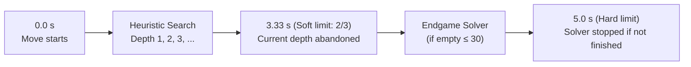

# 10 – Time control

[Back to the index](README.md)

## In short

How long the computer may think is set in the Settings dialog, with the same three modes as Stello. The search has a **soft** limit (do not start another depth) and a **hard** limit (stop at once and play the best move of the last finished depth). When the endgame solver follows, the heuristic search already stops at the soft limit and the solver gets the time up to the hard limit.

## The limits

`SearchLimits` ([SearchLimits.cs](../../Connect4.Net/Connect4.Engine/SearchLimits.cs)):

| Mode | Created with | In the app |
|---|---|---|
| `FixedDepth` | `SearchLimits.FixedDepth(plies)` | 1–20 plies |
| `TimePerMove` | `SearchLimits.TimePerMove(time)` | 1–60 seconds (default 5) |
| `TimePerGame` | `SearchLimits.TimePerGame(remaining)` | 1–60 minutes for the whole game |
| `Solve` | `SearchLimits.Solve` | Not in the app; the tests use it |

`EndgameThreshold` (0–42, default 30) says from how many empty cells the endgame solver is tried in the two time modes (chapter 09, which also shows how the default was measured). The app's `GameSettings.ToLimits` builds the limits from the settings.

## Soft and hard limits

[TimeControl.cs](../../Connect4.Net/Connect4.Engine/Search/TimeControl.cs) turns the limits into a `TimeBudget`:

| Mode | Time for the move | Soft limit | Hard limit |
|---|---|---|---|
| Time per move | The setting | 2/3 of it | All of it |
| Time per game | $\max(10\ \text{ms}, \text{remaining} / \max(1, \lfloor(\text{empty} + 1) / 2\rfloor))$ | 2/3 of it | All of it |
| Fixed depth, Solve | — | None | None |

In time-per-game mode the computer makes at most half of the remaining moves, so the time left is shared evenly over them. When the clock is used up, every move still gets 10 ms. The app maintains real-time ticking chess clocks for both players (counting down every 250 ms during a turn) and refunds consumed time when moves are taken back with Undo (chapters 12 and 13). If a human player's clock reaches 0:00, a timeout continuation prompt allows casual play to continue.

- After each depth the search stops if the soft limit has passed, because the next depth would take longer than the time left.
- The hard limit is checked every 1 024 nodes. When it is reached, the running depth is abandoned and the result of the last finished depth is used.
- When the endgame solver follows (enough cells are empty, chapter 09), the heuristic search treats the soft limit as its hard limit: the running depth is abandoned there, so the solver always gets the last third of the time, up to the hard limit. If it does not finish, the heuristic move is played.

One move with 5 seconds per move, when few enough cells are empty for the solver:

Without the solver, the depth that is running at the soft limit may finish, or be abandoned at the hard limit. With the solver, as here, it is abandoned at the soft limit, so the solver always gets the last third (1.67 s).

## Move Now and stopping

`Search` takes two tokens:

| Token | Effect |
|---|---|
| `moveNowToken` | Stop and return the best move found so far (Quick Action button, Ctrl+M, and Game > Move Now in the desktop app) |
| `cancellationToken` | Stop and throw `OperationCanceledException` (New Game, Undo, Open, changing the mode, closing the window) |

Both are checked with the hard limit every 1 024 nodes. In the browser the worker reads a stop signal from shared memory at each progress report (at least every 100 ms) and cancels the tokens itself; only if the page is not cross-origin isolated, or the worker does not answer within 300 ms, is the worker terminated (chapter 12).

---

Previous: [09 Endgame solver](09-endgame-solver.md) · Next: [11 Opening book](11-opening-book.md)
