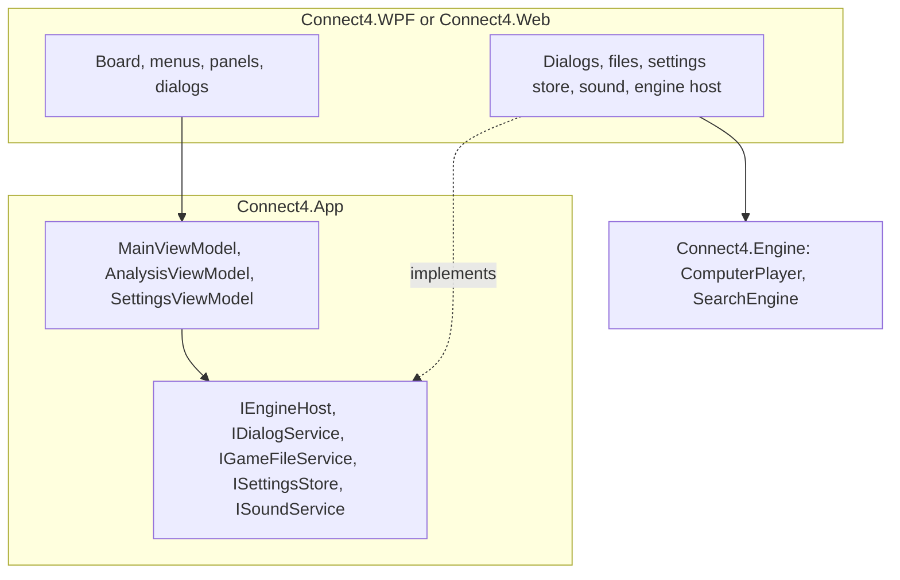
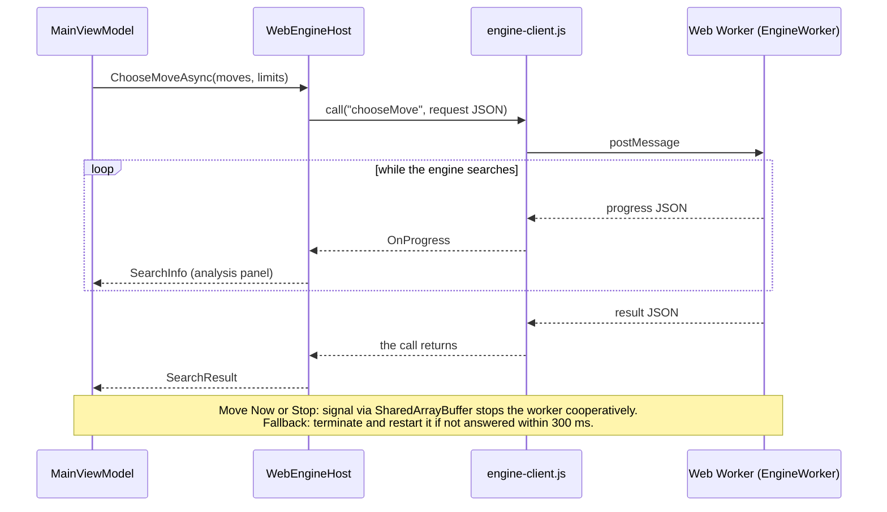

# 12 – App integration

[Back to the index](README.md)

## In short

The desktop app (WPF) and the web app (Blazor WebAssembly) share one view model, `MainViewModel` in `Connect4.App`. It runs the game: it plays the human's moves, asks the engine for the computer's moves in the background, and updates the board, the status and the analysis panel. The two apps only provide the windows and a few services.

## Layers

In the web app the page frame (menu bar, mobile drawer, keyboard shortcuts, status panel and player cards, analysis panel, move history), the dialog frame and the `/docs` viewer come from the shared Razor class library [GameShell](https://github.com/cjp-dev/GameShell) (git submodule `external/GameShell`; clone with `--recurse-submodules`). Connect 4 adds its menus, the board, the Settings form (`SettingsForm.razor`), `BrowserDialogService` (on top of GameShell's `ShellDialogs`) and `AnalysisAdapter` (shows `AnalysisViewModel` in GameShell's analysis panel).

## The game loop

`MainViewModel` ([MainViewModel.cs](../../Connect4.Net/Connect4.App/ViewModels/MainViewModel.cs)):

1. `PlayCommand(column)` beeps if the computer is thinking, the game is over, it is not a human's turn, or the column is full. Otherwise it plays the move, plays the drop sound and starts the loop.
2. The loop refreshes the board. If the game is over it shows the result and plays the win, loss or draw sound. If a human is to move it waits. Otherwise it asks the engine for a move.
3. The computer's move is played like a human move, and the loop goes on.

Commands that change the game (New Game, Open, Undo, Redo, Switch Sides, changing the mode) first cancel a running search and wait until it has stopped.

| Mode | Who plays | First move | Undo / Redo | Switch Sides |
|---|---|---|---|---|
| vs Computer (Red) (`HumanVsComputer`) | Human plays Red, Computer plays Yellow | Human | 2 plies (back to human's turn) | Human swaps to Yellow |
| vs Computer (Yellow) (`ComputerVsHuman`) | Computer plays Red, Human plays Yellow | Computer (opens at once) | 2 plies (back to human's turn) | Human swaps to Red |
| vs Human (`HumanVsHuman`) | Two players share the board locally | Player 1 (Red) | 1 ply | Disabled |

When starting a new game or changing modes while a match is underway, `MainViewModel` asks the user for confirmation via `IDialogService.ConfirmAsync` to prevent accidental loss of game progress.

In single-player modes vs the computer, taking back moves, swapping sides mid-game, editing settings during play, or continuing after clock expiration sets `IsGameModified = true`, turning the UI `STATUS` label crimson red (`#E74C3C`) to indicate that competitive match integrity has been altered (chapter 13). In Human vs Human the analysis panel stays empty.

## Chess clocks and timeout continuation

When **Time per Game** is configured (chapter 10), `MainViewModel` initializes chess clocks for both players and drives a $250\text{ ms}$ ticking timer for the active player's clock bank once the first move is made:

- **Time refunds on Undo:** Time consumed during undone plies is tracked per ply and refunded back to the player's clock when `Undo` is clicked.
- **Computer timeout:** If the computer runs out of time, the match concludes immediately with a human victory on time (*"Game over, you won on time."*).
- **Human timeout continuation:** If the human player's clock expires (`0:00`), a dialog prompts: *"You ran out of time! Do you want to continue playing?"*. If the player agrees, the clock freezes at `0:00`, the match continues casually, and `IsGameModified` is flagged.

## The engine host

`IEngineHost.ChooseMoveAsync(moves, limits, progress, cancel, moveNow)` gets the game as a list of columns, so the engine gets its own copy.

- **Desktop:** `LocalEngineHost` rebuilds the game and runs `ComputerPlayer.ChooseMove` on a thread-pool thread. `Progress<SearchInfo>` brings the reports back to the UI thread.
- **Browser:** `WebEngineHost` sends the request as JSON to a **Web Worker** that runs its own .NET runtime with the engine (`Worker/EngineWorker.cs`, `wwwroot/js/engine-worker.js`). Progress reports come back as messages, at most one per 100 ms unless the depth, the best move or the solver state changes (and at least every 100 ms via heartbeats). Move Now and Stop send a signal through shared memory (`SharedArrayBuffer`), which the worker checks at each progress report and cancels the search cooperatively, keeping the hash tables. Only when the signal is unavailable (not cross-origin isolated) or unanswered within 300 ms is the worker terminated and restarted.

In both, `NewGame()` clears the search hash table.

One computer move in the browser:

## The analysis panel

`AnalysisViewModel` formats the engine search progress and results across 7 distinct telemetry properties: `Move` (current candidate evaluated), `Depth` (search plies, endgame solve status, or opening book), `Score` (heuristic score or proven win distance from Red's view), `BestMove` (current principal candidate column), `Nodes` (total visited states), `Speed` (throughput in nodes per second, `nps`), and `Time` (elapsed stopwatch). It raises an `Updated` event so view components re-render immediately. During long search iterations and endgame solves, heartbeats ensure progress reports continue arriving at least every 100 ms so elapsed time and nodes update smoothly. See chapter 13 for the visual panel layout and telemetry formatting rules.

## The board

| | Desktop | Browser |
|---|---|---|
| Columns | Seven transparent buttons over the board | Seven `<button>` columns |
| Hover | The next disc above the column (`MainViewModel.NextDisc`) | The same, with CSS |
| Drop animation | A falling `TranslateTransform`, accelerating | A CSS animation, accelerating |
| Clicks while a disc falls | Ignored | Ignored |
| Many discs at once (Open, Redo) | Shown at once | Shown at once |
| Winning line, last move | A white ring, a small dot | The same |
| Themes | — | Blue, Golden Oak, Reddish Wood; 3D discs; animation on or off |

## Settings and files

| | Desktop | Browser |
|---|---|---|
| Settings | `%AppData%\Connect4\settings.json` | Local storage (`connect4.settings`, `connect4.appearance`) |
| Games | Open and Save dialogs, `.txt` | File picker and download, `.txt` |
| Sound | `SoundPlayer`, one sound after the other | HTML audio, one after the other |

The settings are the time control (chapter 10) with the endgame threshold and "Use opening book" (chapter 11), the game mode, whether the analysis panel and the sound are on, and the window position. The sounds are small WAV files generated by `SoundWaves` in `Connect4.App`, so neither app needs sound files.

## Memory

On the desktop the search table takes 128 MiB and the endgame table about 84 MB, the latter only after the solver has run once. The browser uses the same sizes in its worker, and falls back to smaller tables if the browser cannot allocate them.

---

Previous: [11 Opening book](11-opening-book.md) · Next: [13 GUI and settings](13-gui-and-settings.md)
