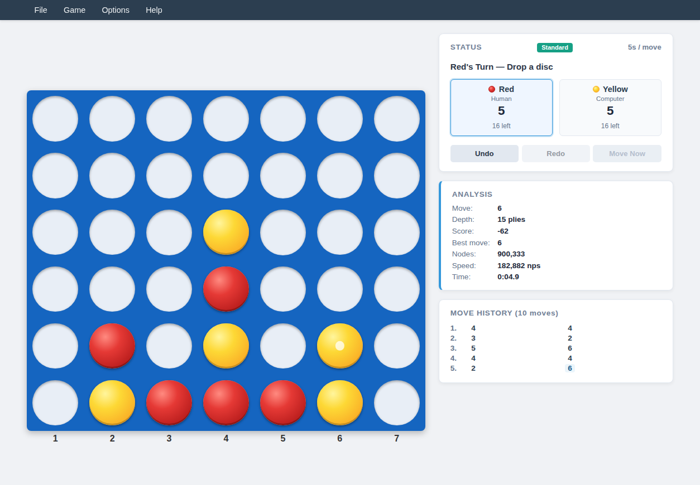
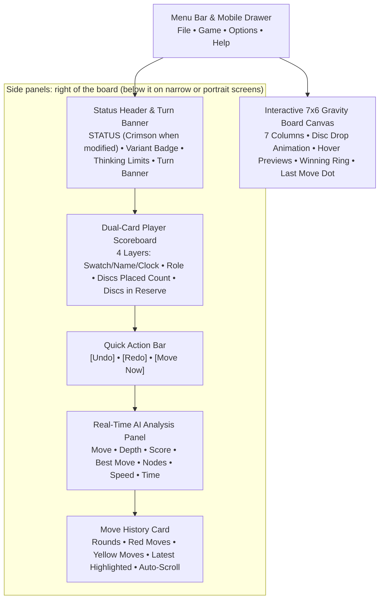
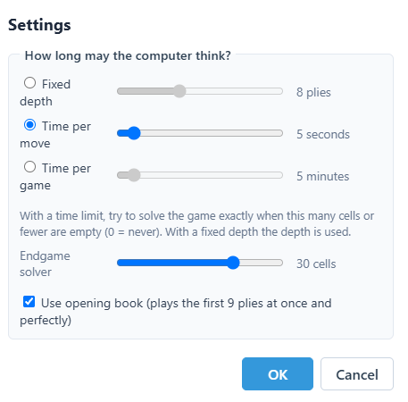
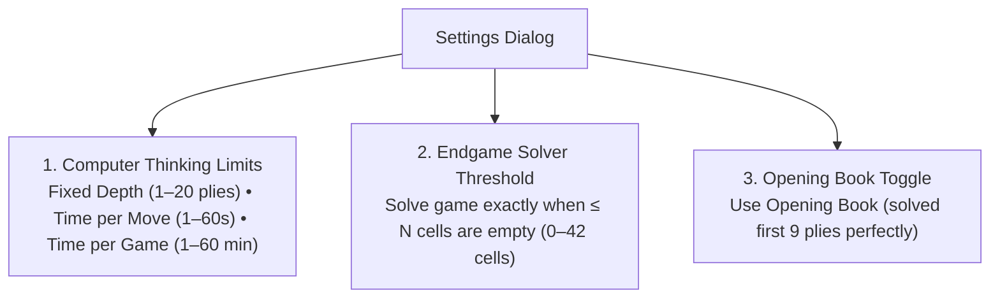

# 13 – GUI and settings

[Back to the index](README.md)

## In short

Connect 4 features a unified, tournament-grade user interface across both **WPF desktop** and **Blazor WebAssembly** clients. Built with a modern light theme, elevated white cards, a dual-card 4-layer scoreboard, quick action controls, responsive mobile drawer, and animated drop physics, the application provides intuitive controls for casual players while exposing professional tournament analysis tools and engine configuration.

This chapter documents the visual layout, menu commands, settings configuration, the competitive integrity status system, chess clocks and timeout continuation, the real-time search analysis telemetry streaming engine, and keyboard shortcuts.

---

## Graphical User Interface layout





### Modern Light Theme & Color Palette

Both desktop and web clients share a consistent palette designed for high contrast and visual clarity:

| UI Element | Color Value | Description |
|---|---|---|
| **App Background** | `#F0F2F5` | Clean light gray canvas background |
| **Menubar & Brand Header** | `#2C3E50` | Dark slate navigation bar with high-contrast `#FFFFFF` typography |
| **Card & Panel Surface** | `#FFFFFF` / `#F8FAFC` | Elevated card surfaces with subtle borders and ambient drop shadows |
| **Border Stroke** | `#E2E8F0` / `#CBD5E1` | Subtle $1\text{ px}$ borders separating navigation, cards, and panels |
| **Primary Typography** | `#2C3E50` / `#1E293B` | Deep slate gray text ensuring optimal readability |
| **Active Turn Highlight** | `#3498DB` / `#EFF6FF` | Sky-blue ring, border, and light tint highlighting the active player card |
| **Status Modified Notice** | `#E74C3C` | Crimson red text for `STATUS` indicating altered/casual match state |
| **Red Player Swatch** | `#D32F2F` | Vivid red circular swatch for Player 1 |
| **Yellow Player Swatch** | `#FBC02D` | Bright yellow circular swatch for Player 2 |
| **Move Now Warning Action** | `#E67E22` | Amber accent for immediate engine move execution |

---

## Menu bar and navigation

The application header features a standardized 4-menu hierarchy providing structured access to game lifecycle commands, modes, visual options, and documentation. The menus below are those of the web app; the [desktop app's menus](#desktop-wpf-menus) differ a little:

### 1. File Menu
* **New Game (`Ctrl+N`):** Starts a new game session. If a match is actively underway, a confirmation prompt prevents accidental loss of progress (*"Abandon current match and start a new game?"*). Resets clocks, clears undo/redo history, and sets Red for the opening move.
* **Open... (`Ctrl+O`):** Loads saved `.txt` match records in standard column-sequence format (e.g. `4453`) into the active session.
* **Save (`Ctrl+S`):** Saves the game directly to the current active file path (or prompts Save As if unsaved).
* **Save As...:** Prompts file dialog to export the current match sequence to a `.txt` file.

### 2. Game Menu
* **vs Computer (Red):** Configures single-player mode where the **Human plays Red** (moving first). If a match is currently in progress, prompts confirmation before resetting.
* **vs Computer (Yellow):** Configures single-player mode where the **Computer plays Red** (making its opening move immediately) and the **Human plays Yellow** (moving second). Prompts confirmation if a match is underway.
* **vs Human (Two players):** Hot-seat multiplayer mode where two human players share the board locally without AI search.
* *(Separator)*
* **Switch sides:** Allows the human player to swap colors with the computer mid-match during their turn. The game state and move history are preserved, the match is marked modified (`IsGameModified = true`), and the computer immediately begins thinking if it becomes its turn.
* *(Separator)*
* **Settings... (`F2` in the web version):** Opens the modal Game Settings dialog to configure engine thinking limits, endgame solver threshold, and opening book usage.

### 3. Options Menu
* **Analysis (`Ctrl+A`):** Toggles the visibility of the real-time AI search analysis side panel.
* **Sound:** Toggles procedural audio feedback (disc drop click, victory fanfare, defeat chime, and draw tone).
* *(Separator)*
* **Blue Board:** Classic tournament blue plastic grid appearance.
* **Golden Oak Board:** Natural golden oak hardwood cabinet texture.
* **Reddish Wood Board:** Warm mahogany/reddish wood cabinet texture.
* *(Separator)*
* **3D Discs:** Toggles realistic spherical radial lighting gradients on Red and Yellow discs.
* **Animate Drops:** Toggles accelerating physical gravity drop animations when placing discs.

> [!NOTE] Dedicated Quick Action Buttons for Undo & Redo
> In the web app, Undo and Redo are intentionally omitted from the top menu dropdowns (the desktop app has them in its Moves menu). To optimize ergonomics and eliminate menu clutter, Undo and Redo are provided prominently as **Quick Action buttons** beneath the scoreboard and via standard keyboard shortcuts (`Ctrl+Z` / `Ctrl+Y`).

### 4. Help Menu
* **User guide (`F1`):** Opens this chapter directly, providing immediate access to interface instructions, settings explanations, and shortcut tables.
* **Rules & Documentation (`Shift+F1`):** Opens the complete Connect 4 Brain Architecture and Rules manual (`/docs` in the web client).
* **About Connect 4...:** Displays engine version, author credits (Claus Pedersen), and architectural background.

### Desktop (WPF) menus
The desktop app has five menus: **File** (New Game, Open..., Save, Save As..., Exit), **Game** (the three game modes, Switch Sides, **Move Now** `Ctrl+M`, Settings...), **Moves** (Undo `Ctrl+Z`, Redo `Ctrl+Y`), **View** (Analysis `Ctrl+A`, Sound) and **Help** (User guide `F1`, Rules & Documentation `Shift+F1`, About Connect 4...). Settings has no `F2` shortcut there, and the board styles, 3D Discs and Animate Drops are only in the web app.

### Responsive Mobile Navigation Drawer ($\le 768\text{px}$)
On mobile devices and narrow viewports ($\le 768\text{px}$), the horizontal desktop menu bar transforms into a compact header featuring the application brand (`Connect 4`) and a hamburger button (`☰`). Tapping the hamburger slides out an off-canvas navigation drawer (`.mobile-drawer`) with a dimmed backdrop overlay, grouping File, Game, Options, and Help actions into touch-friendly tap targets ($\ge 44\text{px}$). The drawer opens from the right; `Escape` or the ✕ button closes it.

---

## Status header, dual-card scoreboard and quick actions

Located beside the game board, the scoreboard displays real-time match status, chess clocks, and immediate action controls:

```
┌─────────────────────────────────────────────────────────────────┐
│ STATUS [STANDARD]                                    5s / move  │
│ Red's Turn — Drop a disc                                        │
│                                                                 │
│ ┌─────────────────────────────┐   ┌───────────────────────────┐ │
│ │ ● Red              05:00    │   │ ● Yellow         05:00    │ │
│ │ Human                       │   │ Computer                  │ │
│ │ 3                           │   │ 2                         │ │
│ │ 18 left                     │   │ 19 left                   │ │
│ └─────────────────────────────┘   └───────────────────────────┘ │
│                                                                 │
│ [  Undo  ]           [  Redo  ]            [ Move Now ]         │
└─────────────────────────────────────────────────────────────────┘
```

### 1. Status Header & Competitive Integrity
* **Status Label (`STATUS`):** Rendered in neutral slate gray (`#718096`) by default. When an unranked casual action occurs—such as taking back moves against the computer, switching sides mid-game, modifying engine settings during a match, or continuing past clock expiration—the `STATUS` text dynamically turns **crimson red (`#E74C3C`)**, visually indicating that match integrity has been altered.
* **Variant Badge:** A rounded teal badge indicating the standard rules variant (`[STANDARD]`).
* **Thinking Limits Badge:** Summarizes the active AI constraint in the top-right corner (e.g., `5s / move`, `5 min / game`, or `8 plies`). Automatically hidden in two-player mode.
* **Turn Banner:** Displays the current turn guidance (e.g., `Red's Turn — Drop a disc`, `Yellow's Turn — Drop a disc`) or terminal game outcome (`Game over, you win.`, `Game over, the computer wins.`, `Game over, a draw.`).

### 2. Dual-Card Player Scoreboard (4 Vertical Layers)
Each player card is structured into 4 distinct vertical layers:
1. **Layer 1 (Identity & Digital Clock):**
   * Color swatch dot (`.red-dot` / `.yellow-dot`).
   * Player name (`Red` / `Yellow`).
   * Digital countdown chess clock (`M:SS`, e.g. `04:58`) when time controls are active.
   * The card of the player whose turn it is receives the **Active Turn Highlight**: a sky-blue border (`#3498DB`), soft ambient glow, and light blue background tint (`#EFF6FF`).
2. **Layer 2 (Role):** Identifies the player type (`Human`, `Computer`, `Player 1`, or `Player 2`).
3. **Layer 3 (Primary Metric):** Displays the total number of discs placed on the board by this player in large, prominent bold numerals (`0` to `21`).
4. **Layer 4 (Secondary Metric):** Displays the remaining discs in reserve for this player (`21 left` down to `0 left`).

### 3. Quick Action Buttons
Positioned directly beneath the dual player cards:
* **`[Undo]`:** Reverts the previous turn. In single-player mode vs computer, it rewinds 2 plies (both the computer's response and human's move) and refunds elapsed clock time. In 2-player mode, it reverts 1 ply. Marks the game as modified (`#E74C3C`). Disabled at Move 0 or while the AI is thinking.
* **`[Redo]`:** Re-applies the most recently undone move from the redo stack.
* **`[Move Now]`:** Rendered prominently when playing against the computer. While the AI is actively calculating, clicking `[Move Now]` cancels the engine search token (`_moveNow.Cancel()`), forcing the engine to immediately play the best move found in the deepest completed iteration. Disabled when the AI is idle.

### 4. Board Gravity & Fixed Orientation
Connect 4 is played on an upright $7 \times 6$ grid where discs fall by gravity to the lowest unoccupied cell in a column. Unlike board games that reverse perspectives, Connect 4's board orientation remains **strictly fixed** at all times, with columns $1$ through $7$ numbered left-to-right.

### 5. Chess Clocks & Timeout Continuation Safeguard
When **Time per Game** is configured:
1. Both clocks initialize to the full match duration (e.g. `5:00`).
2. The clock of the active player counts down every $250\text{ ms}$, starting upon execution of the first move.
3. Time consumed during an undone turn is refunded back to the player's clock upon `Undo`.
4. If the computer clock expires, the human wins on time immediately (*"Game over, you won on time."*).
5. If the human clock reaches `0:00`, a continuation dialog appears: *"You ran out of time! Do you want to continue playing?"*. Electing to continue freezes the clock at `0:00`, marks `IsGameModified = true`, and turns `STATUS` crimson red (`#E74C3C`).

---

## Game Settings dialog

Accessed via **Game $\rightarrow$ Settings...**, the modal settings dialog configures computer search limits, the endgame solver threshold, and opening book lookup:





### 1. Computer Thinking Limits (Three Modes)
* **Fixed Depth ($1\dots 20$ plies):** Constant deterministic search depth. The computer evaluates all variations up to the specified ply count regardless of time taken.
* **Time per Move ($1\dots 60$ seconds):** Constant thinking budget per turn. The engine uses soft limits ($2/3$ time) to conclude iterations safely before hard timeout interrupts; when the endgame solver will run, the search stops at the soft limit so the solver gets the last third.
* **Time per Game ($1\dots 60$ minutes):** Total match chess clock bank. The engine dynamically calculates move time based on remaining clock time and game phase.

### 2. Endgame Solver Threshold
* Configures when the exact C++ endgame solver is activated ($0$ to $42$ cells).
* In timed search modes, when the number of empty cells on the board drops to or below this threshold, the engine invokes the endgame solver (`EndgameSolver.Solve`) to prove the mathematically exact theoretical outcome (Win, Draw, or Loss).
* Setting the slider to `0` disables the endgame solver and relies exclusively on heuristic evaluation.

### 3. Opening Book Toggle
* Enables or disables lookup in the precomputed opening book database (`OpeningBook.txt`).
* When enabled, the first 9 plies are played instantly and with mathematical perfection directly from the solved database.

---

## Real-Time AI Analysis panel

When enabled via **Options $\rightarrow$ Analysis** (`Ctrl+A`), the telemetry sidebar streams live search statistics while the computer calculates:

```
┌─────────────────────────────────┐
│ ANALYSIS                        │
├───────────────────┬─────────────┤
│ Move:             │ 4           │
│ Depth:            │ 8 plies     │
│ Score:            │ +24         │
│ Best move:        │ 4           │
│ Nodes:            │ 128,450     │
│ Speed:            │ 450,120 nps │
│ Time:             │ 0:01.8      │
└───────────────────┴─────────────┘
```

### Telemetry Fields Explained

| Field | Description & Formatting |
|---|---|
| **Move** | The 1-based column currently being evaluated at the root (`1`–`7`). |
| **Depth** | Current search depth completed: <br/>• Displays `"{depth} plies"` for standard alpha-beta search.<br/>• Displays `"solving ({N} empty)"` when the endgame solver is active.<br/>• Displays `"book"` when playing from the opening book. |
| **Score** | Heuristic evaluation shown from **Red's perspective**:<br/>• Positive (e.g. `+24`): Advantage for Red.<br/>• Negative (e.g. `-15`): Advantage for Yellow.<br/>• `"Red/Yellow wins in N moves"`: Proven winning sequence found.<br/>• `"Draw"`: Solved exact draw. |
| **Best move** | 1-based column of the current principal candidate (`1`–`7`). |
| **Nodes** | Total positions evaluated during this search, formatted with thousands separators (`128,450`). |
| **Speed** | Search throughput in nodes per second (`nps`), indicating engine efficiency. |
| **Time** | Elapsed calculation duration in stopwatch format (`m\:ss\.f`, e.g. `0:01.8`). |

### Asynchronous Threading & Web Workers
To guarantee that the UI never stutters or freezes during intense tree search:
- **Desktop (WPF):** The engine executes on background thread-pool tasks via `LocalEngineHost`, reporting telemetry snapshots through `IProgress<SearchInfo>`.
- **Browser (Blazor WebAssembly):** The engine runs in a dedicated browser **Web Worker** (`WebEngineHost` / `EngineWorker.cs`). Messages stream asynchronously via `postMessage`, with heartbeats ensuring the UI updates at 60 FPS even during long endgame solves.

---

## Move History panel

The move history panel gives players a readable transcript of the match, grouping moves into numbered rounds:

```
┌─────────────────────────────────┐
│ MOVE HISTORY (5 moves)          │
├─────────────────────────────────┤
│ 1. 4    4                       │
│ 2. 4    3                       │
│ 3. 5                            │
└─────────────────────────────────┘
```

* **Round Numbering:** Each row is one round: the round number (`1.`, `2.`, `3.`), Red's column, then Yellow's column. The header counts the individual moves of both players (`1 move`, `5 moves`).
* **Latest move & Auto-Scroll:** The newest move is highlighted, and the list scrolls itself to keep it in view.

---

## Keyboard shortcuts reference

| Shortcut | Scope | Action |
|---|---|---|
| `F1` | Global | Open **User guide** (this chapter) |
| `Shift+F1` | Global | Open **Rules & Documentation** (architectural manual) |
| `F2` | Global (web) | Open the **Settings** dialog |
| `Ctrl+N` | Global | **New Game** (asks before abandoning a game in progress) |
| `Ctrl+O` | Global | Open saved game record (`.txt`) |
| `Ctrl+S` | Global | Save current match record |
| `Ctrl+A` | Global | Toggle **AI Analysis Panel** visibility |
| `Ctrl+M` | Engine | **Move Now:** Stop AI calculation and play best candidate |
| `Ctrl+Z` | Board | **Undo** last move (refunds chess clock time) |
| `Ctrl+Y` | Board | **Redo** previously undone move |
| `Escape` | Menus (web) | Close an open menu or the mobile drawer |

*(Note: Settings is also in the menu **Game $\rightarrow$ Settings...**; Undo/Redo are available via Quick Action buttons and `Ctrl+Z`/`Ctrl+Y`).*

---

## Where in the code

| File | Component | Description |
|---|---|---|
| [`MainViewModel.cs`](https://github.com/cjp-dev/Connect-4/blob/main/Connect4.Net/Connect4.App/ViewModels/MainViewModel.cs) | `MainViewModel` | Central orchestrator managing game modes, competitive integrity (`IsGameModified`), chess clocks, turn dispatching, and move history |
| [`AnalysisViewModel.cs`](https://github.com/cjp-dev/Connect-4/blob/main/Connect4.Net/Connect4.App/ViewModels/AnalysisViewModel.cs) | `AnalysisViewModel` | Formats telemetry strings, scores from Red's perspective, node throughput rates (`nps`), and elapsed times |
| [`SettingsViewModel.cs`](https://github.com/cjp-dev/Connect-4/blob/main/Connect4.Net/Connect4.App/ViewModels/SettingsViewModel.cs) | `SettingsViewModel` | Data backing for the Settings dialog (thinking limits, solver threshold, opening book) |
| [`Home.razor`](https://github.com/cjp-dev/Connect-4/blob/main/Connect4.Net/Connect4.Web/Pages/Home.razor) | `Home` | Web page: Connect 4's menus, board styles and shortcuts, built from the shared [GameShell](https://github.com/cjp-dev/GameShell) components (`ShellLayout` with menu bar and mobile drawer, `StatusPanel`, `AnalysisPanel`, `MoveHistoryPanel`) |
| [`Board.razor`](https://github.com/cjp-dev/Connect-4/blob/main/Connect4.Net/Connect4.Web/Components/Board.razor) | `Board` | Connect-4 vector grid, column drop buttons, hover previews, falling disc animations, and winning line highlights |
| [`WebEngineHost.cs`](https://github.com/cjp-dev/Connect-4/blob/main/Connect4.Net/Connect4.Web/Services/WebEngineHost.cs) | `WebEngineHost` | Web Worker host managing asynchronous search dispatching, cooperative cancellation, and progress streaming |

---

## Further reading

- Allis, L. V. (1988). *A Knowledge-based Approach of Connect-Four*. Master's thesis, Vrije Universiteit Amsterdam (First mathematical proof that Connect 4 is a first-player win).
- Pons, P. (2015). *Solving Connect 4: how to build a perfect AI*. GameSolver.org tutorial.
- Tromp, J. (2008). *John's Connect Four Playground*. Fhourstones benchmark and 49-bit bitboard representation.
- Nielsen, J. (1994). *Usability Engineering*. Morgan Kaufmann (Principles of visibility of system status and fair play transparency).

---

Previous: [12 App integration](12-app-integration.md) · Next: [14 Glossary](14-glossary.md)

